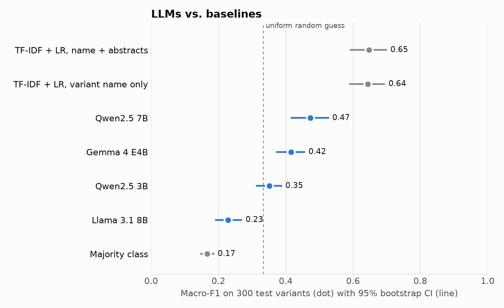
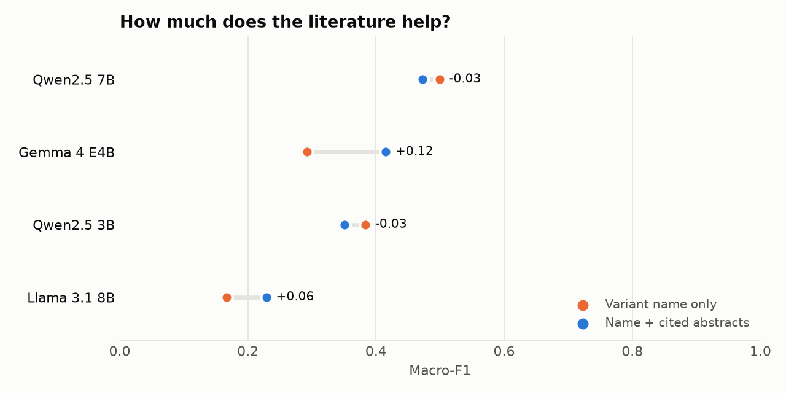
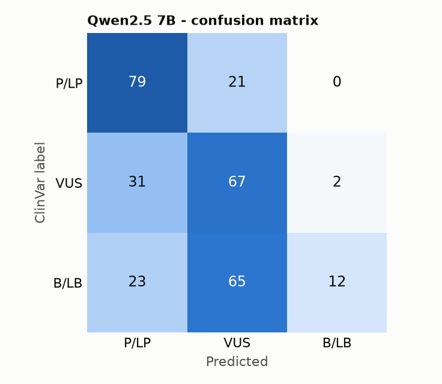
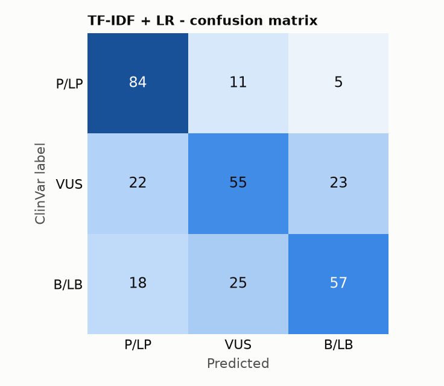

# ClinVar Data Processing and Analysis Pipeline

This project provides a set of scripts to download, process, and analyze data from the ClinVar database, PubMed, and associated publications to prepare it for Large Language Model (LLM) analysis.

## Data Processing Workflow

Follow these steps sequentially to process the data.

### 1. Download ClinVar Database
First, download the ClinVar database from the official NCBI FTP server:
[https://ftp.ncbi.nlm.nih.gov/pub/clinvar/xml/](https://ftp.ncbi.nlm.nih.gov/pub/clinvar/xml/)

Download the `ClinVarFullRelease_*.xml.gz` file and rename it to `clinvar_dataset.xml.gz`.

### 2. Convert ClinVar XML to CSV
Run the following script to convert the downloaded XML data into a CSV file. This will create `data/clinvar_csv_dataset.csv`.

```bash
python3 src/s01_clinvar_xml_to_csv.py
```

### 3. Fetch PubMed Abstracts
This script extracts unique PubMed references from the CSV file and fetches the abstract for each article.

```bash
python3 src/s03_fetch_pubmed_abstracts.py
```

### 4. Download Linked PDFs
To train the model, you will also need the full text from linked PDF articles.

**a. Generate DOI list:**
First, create a `dois.txt` file containing all the DOIs from the dataset.
```bash
python3 scripts/make_doi_txt.py
```

**b. Download PDFs with PyPaperBot:**
Use `PyPaperBot` to download the PDFs using the generated DOI list. Using `--use-doi-as-filename` is recommended for easier retrieval later.

```bash
python3 -m PyPaperBot --doi-file="dois.txt" --dwn-dir="./papers_by_doi" --use-doi-as-filename
```

### 5. Extract Text from PDFs
Process the downloaded PDFs to extract their text content.

```bash
python3 src/s04_extract_pdfs.py
```

### 6. Prepare Data for Analysis
This script preprocesses and organizes the data from all previous steps (CSV, abstracts, PDF text) to make it ready for modeling.

```bash
python3 src/s05_data_preparation.py
```

### 7. LLM Analysis
Once the data is prepared, use this script to perform the analysis with a Large Language Model.

```bash
python3 src/s06_LLM_analysis.py
```

## Additional Scripts

### Data Visualization
*   `scripts/make_graphics.py`: Generates various plots and graphics from the ClinVar CSV data.

### Data Exploration
*   `src/s02_analyze_citation_sources.py`: Analyzes the citation sources in the dataset. We chose to focus on PubMed as it comprises the majority of citations.
*   `scripts/clinvar_preview.py`: A utility script to inspect a small snippet of the ClinVar XML. It can be used with the provided `data/example.xml`.
*   `scripts/find_variants_with_papers.py`: A script to identify and list genetic variants that have associated scientific papers.

### Helper Scripts & Utilities
*   `scripts/structure_data.py`: A helper script to structure data into the final format required for the LLM input.
*   `scripts/find_duplicates.py`: A utility to find and report duplicate entries within the dataset.
*   `scripts/num_words_in_pdf.py`: Calculates and shows the word count for the extracted text from the downloaded

<!-- results:start (generated by `make report`; do not edit by hand) -->
## Results

Test split: 300 variants (P/LP, VUS, B/LB: 100 each).

| System | Macro-F1 [95% CI] | Accuracy [95% CI] | F1 P/LP | F1 VUS | F1 B/LB | Invalid | Median s/variant |
|---|---|---|---|---|---|---|---|
| TF-IDF + LR, name + abstracts | 0.647 [0.592, 0.699] | 0.653 [0.600, 0.707] | 0.75 | 0.58 | 0.62 | 0.0% | - |
| TF-IDF + LR, variant name only | 0.644 [0.590, 0.693] | 0.637 [0.583, 0.690] | 0.77 | 0.57 | 0.59 | 0.0% | - |
| Qwen2.5 7B (no evidence) | 0.499 [0.440, 0.555] | 0.533 [0.477, 0.587] | 0.64 | 0.57 | 0.29 | 0.0% | 6.6 |
| Qwen2.5 7B | 0.473 [0.417, 0.526] | 0.527 [0.470, 0.583] | 0.68 | 0.53 | 0.21 | 0.0% | 11.6 |
| Gemma 4 E4B | 0.415 [0.374, 0.456] | 0.503 [0.447, 0.560] | 0.65 | 0.57 | 0.02 | 0.0% | 9.7 |
| Qwen2.5 3B (no evidence) | 0.384 [0.343, 0.421] | 0.477 [0.420, 0.533] | 0.59 | 0.56 | 0.00 | 0.0% | 3.1 |
| Qwen2.5 3B | 0.351 [0.314, 0.387] | 0.440 [0.387, 0.493] | 0.60 | 0.46 | 0.00 | 0.0% | 5.0 |
| Gemma 4 E4B (no evidence) | 0.292 [0.247, 0.338] | 0.393 [0.340, 0.450] | 0.34 | 0.51 | 0.02 | 0.0% | 4.5 |
| Llama 3.1 8B | 0.229 [0.192, 0.269] | 0.363 [0.307, 0.420] | 0.53 | 0.11 | 0.04 | 0.0% | 13.4 |
| Llama 3.1 8B (no evidence) | 0.167 [0.146, 0.186] | 0.333 [0.280, 0.387] | 0.50 | 0.00 | 0.00 | 0.0% | 6.5 |
| Majority class | 0.167 [0.147, 0.186] | 0.333 [0.283, 0.387] | 0.00 | 0.00 | 0.50 | 0.0% | - |

### Paired comparisons (A - B)

Δ = metric(A) - metric(B) on the same 300 variants. Bootstrap p is one-sided (H1: A > B); McNemar p is two-sided, on per-variant correctness.

| A | B | Δ macro-F1 [95% CI] | Bootstrap p (A > B) | Δ accuracy | McNemar p |
|---|---|---|---|---|---|
| Qwen2.5 7B | TF-IDF + LR, name + abstracts | -0.175 [-0.243, -0.108] | 1.000 | -0.127 | 0.000598 |
| Qwen2.5 7B | TF-IDF + LR, variant name only | -0.171 [-0.239, -0.105] | 1.000 | -0.110 | 0.00269 |
| Gemma 4 E4B | Gemma 4 E4B (no evidence) | +0.123 [+0.072, +0.172] | 0.000 | +0.110 | 1.92e-05 |
| Llama 3.1 8B | Llama 3.1 8B (no evidence) | +0.062 [+0.030, +0.095] | 0.000 | +0.030 | 0.00391 |
| Qwen2.5 3B | Qwen2.5 3B (no evidence) | -0.032 [-0.079, +0.014] | 0.913 | -0.037 | 0.278 |
| Qwen2.5 7B | Qwen2.5 7B (no evidence) | -0.026 [-0.096, +0.039] | 0.790 | -0.007 | 0.913 |





<!-- results:end -->
